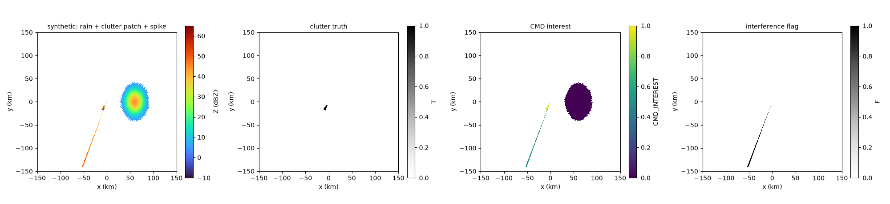
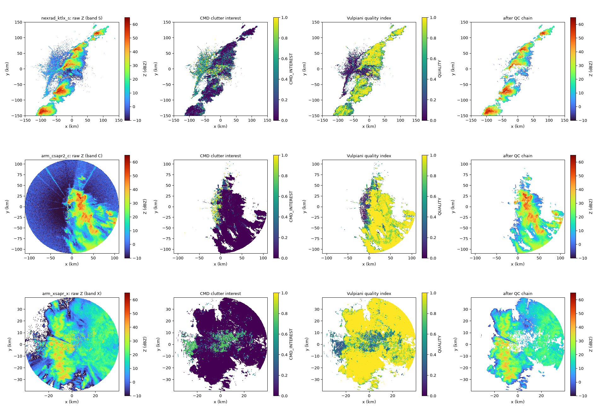

# radarwow-qc

**radar-wow stage 2: Quality control.** Noise, ground clutter, biological echo, interference, speckle.

Part of [radar-wow](https://github.com/radar-wow), a set of repos that together build a radar QPE system that works for S, C and X band radars.
Every algorithm is one class implementing one paper, with the same interface: it takes an xradar sweep or volume with canonical moment names, declares the bands and moments it needs, and records provenance.

## Sub-components

| sub-component | algorithm | source | DOI | status |
|---|---|---|---|---|
| noise | `SignalMask` | SNR/SQI, else measured noise floor |  | implemented + notebook |
| ground clutter | `Hubbert2009CMD` | Hubbert, Dixon & Ellis 2009, JTECH | [doi:10.1175/2009JTECHA1160.1](https://doi.org/10.1175/2009JTECHA1160.1) | implemented + notebook |
| non-meteorological echo | `Vulpiani2012QualityMap` | Vulpiani et al. 2012, JAMC | [doi:10.1175/JAMC-D-10-05024.1](https://doi.org/10.1175/JAMC-D-10-05024.1) | implemented + notebook |
| RLAN / sun / emitters | `InterferenceSpikes` | Saltikoff et al. 2016, BAMS | [doi:10.1175/BAMS-D-15-00048.1](https://doi.org/10.1175/BAMS-D-15-00048.1) | implemented + notebook |
| speckle | `Despeckle` | connected-component size filter |  | implemented + notebook |
| birds / insects | `MistNet` | Lin et al. 2019, Methods Ecol. Evol. | [doi:10.1111/2041-210X.13280](https://doi.org/10.1111/2041-210X.13280) | stub |
| dual-pol QC (operational) | `MRMSdpQC` | Tang et al. 2014 (talk) |  | to review |

## Install

```bash
pip install git+https://github.com/radar-wow/radarwow-core git+https://github.com/radar-wow/radarwow-qc
```

## Notebooks (free data, S / C / X band)

- [`notebooks/01_qc_chain_s_c_x.ipynb`](notebooks/01_qc_chain_s_c_x.ipynb): open in Colab via `https://colab.research.google.com/github/radar-wow/radarwow-qc/blob/main/notebooks/01_qc_chain_s_c_x.ipynb`

## Results




## Usage

```python
from radarwow.core import load_sample
from radarwow.qc import *  # see table above

vol = load_sample('arm_csapr2_c')        # or open_volume('my_file')
# out = SomeAlgorithm()(vol)            # band read from the file, or band='S'|'C'|'X'
```

## Status legend

*implemented + notebook*: code, tests, executed notebook. *planned*: interface fixed, code to write. *stub*: class exists, raises `NotImplementedError`. *to review*: paper to read before deciding.

## License

MIT. Data used in the notebooks comes from public archives (NEXRAD on AWS, ARM, IMD via open-radar-data) under their own terms.
